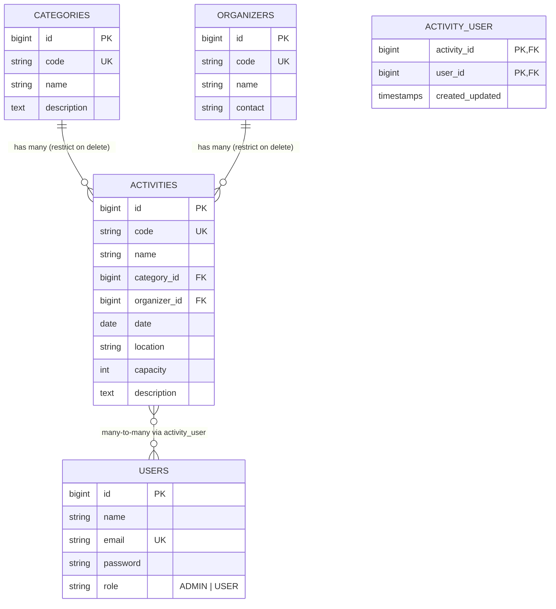

# แผนโปรเจกต์ — ระบบสมัครเข้าร่วมกิจกรรม

> ใช้คู่กับ `PROJECT_RULES.md` — ถ้ามีอะไรขัดกัน ให้ยึด requirement ของอาจารย์เป็นหลัก
> สถานะ: **ตกลงในกลุ่มแล้ว (14 ต.ค. 2569)** · ฐานร่วม (ขั้นที่ 1) เสร็จแล้ว (20 ต.ค. 2569) — ยังเหลือกรอกชื่อสมาชิก (ข้อ 12)

## สารบัญ

1. [แนวคิด](#1-แนวคิด)
2. [Models และความสัมพันธ์](#2-models-และความสัมพันธ์)
3. [ตารางและ Field](#3-ตารางและ-field)
4. [Role และสิทธิ์](#4-role-และสิทธิ์)
5. [Routes](#5-routes)
6. [กฎของระบบ (Business rules)](#6-กฎของระบบ-business-rules)
7. [Validation](#7-validation)
8. [ข้อความแจ้งเตือน](#8-ข้อความแจ้งเตือน)
9. [PHP Library (R6) — dompdf](#9-php-library-r6--dompdf)
10. [แนวทางเขียนโค้ด](#10-แนวทางเขียนโค้ด)
11. [Requirement → ฟีเจอร์](#11-requirement--ฟีเจอร์)
12. [การแบ่งงาน](#12-การแบ่งงาน)
13. [ลำดับการทำงาน](#13-ลำดับการทำงาน)
14. [Environment และบัญชีทดสอบ](#14-environment-และบัญชีทดสอบ)
15. [คำถามที่ต้องถามอาจารย์](#15-คำถามที่ต้องถามอาจารย์)

---

## 1. แนวคิด

ทำเว็บ **ระบบสมัครเข้าร่วมกิจกรรม** ด้วย Laravel + Blade
ใช้เว็บที่ทำพร้อมอาจารย์ในคาบ (`my-db`: Product – Shop – Category – User) เป็น **reference** ของวิธีเขียน แต่สร้างโปรเจกต์ใหม่ (`laravel new`) และเขียนเองทั้งหมด

- **คนทั่วไป (ไม่ login):** ดูหน้าแรก รายการกิจกรรม และรายละเอียดกิจกรรมได้ และสมัครสมาชิกได้
- **สมาชิก (USER):** สมัคร/ยกเลิกกิจกรรม ดูกิจกรรมที่ตัวเองสมัคร ดาวน์โหลดบัตรเข้าร่วม (PDF)
- **ผู้ดูแล (ADMIN):** จัดการหมวดหมู่ ผู้จัด กิจกรรม และดูรายชื่อผู้สมัคร

| เว็บในคาบ (`my-db`) | โปรเจกต์นี้ |
|---|---|
| Category 1–N Product | Category 1–N Activity |
| Shop | Organizer 1–N Activity |
| Product N–N Shop (`product_shop`) | Activity N–N User (`activity_user`) = การสมัคร |
| ทุกหน้าต้อง login | มีหน้า public + หน้าสมัครสมาชิก |
| ไม่มี library ภายนอก | dompdf ทำบัตรเข้าร่วม PDF |

---

## 2. Models และความสัมพันธ์



```php
// Category.php
#[Fillable(['code', 'name', 'description'])]
function activities(): HasMany { return $this->hasMany(Activity::class); }

// Organizer.php
#[Fillable(['code', 'name', 'contact'])]
function activities(): HasMany { return $this->hasMany(Activity::class); }

// Activity.php
#[Fillable(['code', 'name', 'date', 'location', 'capacity', 'description'])]   // ไม่ใส่ category_id, organizer_id
function category(): BelongsTo     { return $this->belongsTo(Category::class); }
function organizer(): BelongsTo    { return $this->belongsTo(Organizer::class); }
function participants(): BelongsToMany {
    return $this->belongsToMany(User::class)->withTimestamps();   // ตาราง activity_user
}

// User.php
#[Fillable(['name', 'password'])]   // ไม่ใส่ email, role
function activities(): BelongsToMany {
    return $this->belongsToMany(Activity::class)->withTimestamps();
}
function isAdministrator(): bool { return $this->role === 'ADMIN'; }
```

- ชื่อ relationship `participants()` ต่างจากชื่อ model (`User`) ได้ เพราะ Laravel ใช้ **ชื่อ model** ตั้งชื่อตาราง pivot (`activity_user`) และ FK (`activity_id`, `user_id`)
- นับผู้สมัครด้วย `withCount('participants')` → `$activity->participants_count`

---

## 3. ตารางและ Field

ทุกตารางมี `id`, `created_at`, `updated_at` (มี index) ตามแบบในคาบ

### `categories`
| Field | Type | หมายเหตุ |
|---|---|---|
| `code` | string(64) | unique, เช่น `CT001` |
| `name` | string(255) | |
| `description` | text | |

### `organizers`
| Field | Type | หมายเหตุ |
|---|---|---|
| `code` | string(64) | unique, เช่น `OG001` |
| `name` | string(255) | |
| `contact` | string(255) | เบอร์โทรหรืออีเมลติดต่อ |

### `activities`
| Field | Type | หมายเหตุ |
|---|---|---|
| `code` | string(64) | unique, เช่น `AC001` |
| `name` | string(255) | |
| `category_id` | FK → `categories.id` | `restrictOnDelete()` |
| `organizer_id` | FK → `organizers.id` | `restrictOnDelete()` |
| `date` | date | วันจัดกิจกรรม |
| `location` | string(255) | สถานที่ |
| `capacity` | unsigned integer | จำนวนรับ |
| `description` | text | |

### `activity_user` (pivot = การสมัคร)
| Field | Type | หมายเหตุ |
|---|---|---|
| `activity_id` | FK → `activities.id` | `cascadeOnDelete()` |
| `user_id` | FK → `users.id` | `cascadeOnDelete()` |
| timestamps | | เวลาสมัคร |
| | | primary key คู่ `(activity_id, user_id)` → กันสมัครซ้ำระดับ DB |

### `users` (ของ Laravel + เพิ่ม)
| Field | Type | หมายเหตุ |
|---|---|---|
| `role` | string(32) | NOT NULL, `ADMIN` หรือ `USER` |

> สร้าง `role` ใน migration ใหม่ตั้งแต่แรกได้เลย (โปรเจกต์ใหม่ ไม่ต้องทำ 3 ขั้นแบบในคาบ)

**พฤติกรรมตอนลบ**
- ลบ Category / Organizer ที่ยังมีกิจกรรม → DB ไม่ยอม (`restrict`) และ Policy ซ่อนปุ่ม Delete
- ลบ Activity → การสมัครของกิจกรรมนั้นถูกลบตาม (`cascade`)
- ลบ User → การสมัครของ user นั้นถูกลบตาม (`cascade`)

---

## 4. Role และสิทธิ์

| ทำอะไร | ไม่ login | USER | ADMIN |
|---|:---:|:---:|:---:|
| ดูหน้าแรก / รายการกิจกรรม / รายละเอียดกิจกรรม | ✅ | ✅ | ✅ |
| สมัครสมาชิก | ✅ | – | – |
| สมัคร / ยกเลิกกิจกรรม | ❌ (ไป login) | ✅ | ❌ |
| ดูกิจกรรมที่ตัวเองสมัคร | ❌ | ✅ | ❌ |
| ดาวน์โหลดบัตรเข้าร่วม PDF | ❌ | ✅ (เฉพาะที่สมัครแล้ว) | ❌ |
| CRUD กิจกรรม | ❌ | ❌ | ✅ |
| ดูหมวดหมู่ / ผู้จัด (รายการ, รายละเอียด, กิจกรรมในหมวด/ผู้จัด) | ❌ (ไป login) | ✅ | ✅ |
| สร้าง / แก้ / ลบ หมวดหมู่ / ผู้จัด | ❌ | ❌ (ปุ่มซ่อน + 403) | ✅ |
| ดูรายชื่อผู้สมัครของกิจกรรม | ❌ | ❌ | ✅ |

### Policies

| Policy | Method | เงื่อนไข |
|---|---|---|
| `ActivityPolicy` | `list(?User $user)`, `view(?User $user)` | `true` — **ต้องใส่ `?` ให้คนไม่ login ผ่านได้** |
| | `create`, `update` | `isAdministrator()` |
| | `delete` | เหมือน `update` |
| | `viewParticipants` | เหมือน `update` |
| | `register(User $user, Activity $activity)` | role USER **และ** ยังไม่เคยสมัคร **และ** ยังไม่เต็ม **และ** ยังไม่ถึงวันจัด |
| | `cancel(User $user, Activity $activity)` | สมัครแล้ว **และ** ยังไม่ถึงวันจัด |
| | (บัตร PDF) | `TicketController` ค้นจาก `$user->activities()` เท่านั้น → ไม่ได้สมัคร = 404 |
| `CategoryPolicy` | `list()`, `view()` | `true` — ทุกคนที่ login (route ครอบ `auth` อยู่แล้ว) **เหมือน `CategoryPolicy` ในคาบ** |
| | `create`, `update` | `isAdministrator()` |
| | `delete` | admin **และ** `activities_count === 0` (ใช้ `loadCount('activities')`) |
| `OrganizerPolicy` | เหมือน `CategoryPolicy` | |

ใช้ 2 ชั้นตามที่เรียน:
- Controller: `Gate::authorize(...)` (ไม่มีสิทธิ์ → 403) — **ห้ามใช้ `$this->authorize()`** เพราะ Laravel 11+ ไม่มีใน base Controller
- View: `@can(...) ... @endcan` ซ่อนปุ่ม, `@auth` / `@guest` สลับเมนู

---

## 5. Routes

ทุก route ครอบด้วย `cache.headers:no_store;no_cache;must_revalidate;max_age=0`

route แยกไฟล์ตามเจ้าของงาน แล้ว `routes/web.php` `require` เข้ามารวมกัน: `auth.php`, `activities.php`, `categories.php`, `tickets.php`, `organizers.php`, `my-activities.php` — ผลเหมือนเขียนไฟล์เดียว (ดูได้จาก `php artisan route:list`)

แต่ละ resource เขียนแบบเดียวกับ `/products`, `/categories` ใน `web.php` ของ my-db:
`GET /xxx/list` = หน้ารายการ (`xxx.list`) · `ANY /xxx` → redirect ไป list (`xxx.index`) · เมนูและปุ่ม Back ลิงก์ไป `xxx.index`
(ไม่ต้องใส่บรรทัด `Route::post('', 'list')` ที่ซ้ำกับ `create` ในคาบ)

> ⚠️ **ลำดับการประกาศใน `routes/activities.php`** (ตัวอย่างในคอมเมนต์ของไฟล์เรียงถูกแล้ว):
> 1. `ANY /activities` (index) ต้องอยู่ **ก่อน** `POST /activities` (create) เหมือนในคาบ — ถ้าสลับ ANY จะทับ POST แล้วกดสร้างกิจกรรมจะโดน redirect แทนการบันทึก
> 2. กลุ่ม `auth` (มี `/activities/create`) ต้องอยู่ **ก่อน** `GET /activities/{activity}` (public) — ไม่งั้นคำว่า `create` จะถูกจับเป็น `{activity}`

### Public (ไม่ต้อง login)
| Method | URL | Name | Controller@method |
|---|---|---|---|
| GET | `/` | `home` | `HomeController@index` — กิจกรรมที่ใกล้จะจัด |
| GET | `/activities/list` | `activities.list` | `ActivityController@list` |
| ANY | `/activities` | `activities.index` | redirect → `activities.list` |
| GET | `/activities/{activity}` | `activities.view` | `ActivityController@view` |

### Auth (ไม่ต้อง login)
| Method | URL | Name | Controller@method |
|---|---|---|---|
| GET | `/auth/login` | `login` | `LoginController@showForm` |
| POST | `/auth/login` | `authentication` | `LoginController@authenticate` |
| GET | `/auth/register` | `register-form` | `RegisterController@showForm` |
| POST | `/auth/register` | `register` | `RegisterController@register` |
| POST | `/auth/logout` | `logout` | `LoginController@logout` |

### สมาชิก (ต้อง login, Policy ตรวจ role)
| Method | URL | Name | Controller@method |
|---|---|---|---|
| POST | `/activities/{activity}/register` | `activities.register` | `ActivityController@register` |
| POST | `/activities/{activity}/cancel` | `activities.cancel` | `ActivityController@cancel` |
| GET | `/activities/{activity}/ticket` | `activities.ticket` | `TicketController@download` |
| GET | `/my-activities` | `my-activities.list` | `MyActivityController@list` |

### Admin — Activities (ต้อง login)
| Method | URL | Name | Controller@method |
|---|---|---|---|
| GET | `/activities/create` | `activities.create-form` | `showCreateForm` |
| POST | `/activities` | `activities.create` | `create` |
| GET | `/activities/{activity}/update` | `activities.update-form` | `showUpdateForm` |
| POST | `/activities/{activity}` | `activities.update` | `update` |
| POST | `/activities/{activity}/delete` | `activities.delete` | `delete` |
| GET | `/activities/{activity}/participants` | `activities.view-participants` | `viewParticipants` |

### Categories (ต้อง login) — Organizers ใช้โครงเดียวกันที่ `/organizers`
| Method | URL | Name | Controller@method | สิทธิ์ |
|---|---|---|---|---|
| GET | `/categories/list` | `categories.list` | `list` | ทุกคนที่ login |
| ANY | `/categories` | `categories.index` | redirect → list | ทุกคนที่ login |
| POST | `/categories` | `categories.create` | `create` | ADMIN |
| GET | `/categories/create` | `categories.create-form` | `showCreateForm` | ADMIN |
| GET | `/categories/{category}` | `categories.view` | `view` | ทุกคนที่ login |
| POST | `/categories/{category}` | `categories.update` | `update` | ADMIN |
| GET | `/categories/{category}/update` | `categories.update-form` | `showUpdateForm` | ADMIN |
| POST | `/categories/{category}/delete` | `categories.delete` | `delete` | ADMIN (หมวดว่าง) |
| GET | `/categories/{category}/activities` | `categories.view-activities` | `viewActivities` | ทุกคนที่ login |

---

## 6. กฎของระบบ (Business rules)

| กฎ | ทำที่ไหน | วิธี (อ้างอิงคาบ) |
|---|---|---|
| สมัครซ้ำไม่ได้ | Policy `register` + PK คู่ใน pivot | `$activity->participants()->where('users.id', $user->id)->exists()` |
| สมัครเกินจำนวนรับไม่ได้ | Policy `register` | `loadCount('participants')` เทียบ `capacity` (Week 9) |
| สมัคร/ยกเลิกหลังวันจัดไม่ได้ | Policy `register`, `cancel` | `$activity->date` เทียบ `today()` |
| ADMIN สมัครกิจกรรมไม่ได้ | Policy `register` | ตรวจ `role === 'USER'` |
| แก้ `capacity` ให้น้อยกว่าคนที่สมัครแล้วไม่ได้ | Controller `update` | `loadCount('participants')` แล้วถ้า `capacity` ใหม่น้อยกว่า → `withInput()->withErrors(['alert' => '...'])` |
| ลบหมวด/ผู้จัดที่ยังมีกิจกรรมไม่ได้ | Policy `delete` + FK restrict | `loadCount('activities')` (Week 12) |
| ตั้ง category/organizer ของกิจกรรม | Controller | `associate()` — ห้ามเซ็ต `category_id` ตรง ๆ (Week 10) |
| สมัคร / ยกเลิก | Controller | `attach()` / `detach()` (Week 10) |

ในหน้า view แสดงสถานะให้ผู้ใช้เห็น เช่น "รับ 30 / สมัครแล้ว 12", "เต็มแล้ว", "คุณสมัครกิจกรรมนี้แล้ว" และปุ่มสมัคร/ยกเลิกครอบด้วย `@can`
ถ้ากดเมื่อไม่ผ่าน (เช่น มีคนสมัครแทรกจนเต็ม) controller ตรวจด้วย `Gate::check()` แล้ว redirect กลับพร้อม `withErrors(['alert' => 'ไม่สามารถสมัครกิจกรรมนี้ได้'])`

---

## 7. การตรวจข้อมูล (แบบในคาบ — ไม่ใช้ Validator ใน CRUD)

ใน my-db ตอน create / update **ไม่มี `Validator`** — ใช้ 3 ชั้นนี้แทน ให้ทำแบบเดียวกัน:

1. **HTML** — `required`, `type="email" / "date" / "number"`, `min`, `maxlength` ในฟอร์ม (browser ไม่ให้ส่งค่าว่าง/ผิดรูปแบบ)
2. **ฐานข้อมูล** — `unique`, `NOT NULL`, foreign key ใน migration ถ้าผิด → `QueryException` → `catch` แล้ว `withErrors(['alert' => $excp->errorInfo[2]])` เช่น `Duplicate entry 'CT001' for key 'categories_code_unique'`
3. **Controller** — กฎที่ฐานข้อมูลตรวจไม่ได้ เช็กเองแล้ว `withErrors(['alert' => '...'])` เช่น จำนวนรับต่ำกว่าจำนวนผู้สมัคร · หา category/organizer ด้วย `firstOrFail()` (ไม่เจอ → error)

| ฟอร์ม | HTML | ฐานข้อมูล / controller |
|---|---|---|
| Category | `code`, `name`, `description` required | `code` unique |
| Organizer | `code`, `name`, `contact` required | `code` unique |
| Activity | ทุกช่อง required · `date` type=date · `capacity` type=number min=1 | `code` unique · category/organizer `firstOrFail()` · ตอน update: `capacity` ≥ จำนวนผู้สมัคร (เช็กใน controller) |
| สมัครสมาชิก | `name`, `email` (type=email), `password` required | `email` unique (อีเมลซ้ำ → Duplicate entry) — เขียนแบบ `UserController::create` ใน Lab 13 |

`Validator` ใช้ที่เดียวคือ **login** (เหมือนในคาบ) — แสดง `@error('credentials')`

---

## 8. ข้อความแจ้งเตือน

แสดงใน `layouts/main.blade.php` ที่เดียว ใช้ key แบบในคาบ:

```blade
<div class="app-cmp-notifications">
    @session('status') <div role="status">{{ $value }}</div> @endsession
    @error('alert')    <div role="alert">{{ $message }}</div> @enderror
</div>
```

- สำเร็จ = สีเขียว (`[role=status]`), error = สีแดง (`[role=alert]`)
- ทุกจุดที่แก้ฐานข้อมูลครอบ `try { ... } catch (QueryException $e) { ...errorInfo[2] } catch (\Exception $e) { ...getMessage() }`
- ฟอร์ม (create/update/register) ใช้ `withInput()` + `old()` เพื่อเติมค่าเดิมกลับ (login/สมัครสมาชิก ไม่คืนรหัสผ่าน) · ปุ่ม (delete/สมัคร/ยกเลิก) ไม่ใช้ `withInput()`
- ปุ่ม Back / Cancel ใช้ **bookmarks** แบบ Lab 11: หน้ารายการจด `session()->put('bookmarks.xxx.view', url()->full())` แล้วปุ่ม Back ใช้ `session()->get('bookmarks.xxx.view') ?? route('xxx.index')`

| การกระทำ | ข้อความสำเร็จ |
|---|---|
| create / update / delete กิจกรรม | `กิจกรรม {code} ถูกสร้าง / แก้ไข / ลบแล้ว` |
| create / update / delete หมวด, ผู้จัด | `หมวดหมู่ {code} ...`, `ผู้จัด {code} ...` |
| สมัครกิจกรรม | `สมัครกิจกรรม {name} สำเร็จ` |
| ยกเลิกการสมัคร | `ยกเลิกการสมัคร {name} แล้ว` |
| สมัครสมาชิก | `สมัครสมาชิกสำเร็จ ยินดีต้อนรับ {name}` |

---

## 9. PHP Library (R6) — dompdf

| หัวข้อ | รายละเอียด |
|---|---|
| Package | `barryvdh/laravel-dompdf` (ห่อ `dompdf/dompdf`) |
| ติดตั้ง | `composer require barryvdh/laravel-dompdf` |
| ฟีเจอร์ | **บัตรเข้าร่วมกิจกรรม** — USER ที่สมัครแล้วกด "ดาวน์โหลดบัตร" ได้ไฟล์ PDF |
| เนื้อหาบัตร | ชื่อผู้สมัคร, อีเมล, รหัส/ชื่อกิจกรรม, วันที่, สถานที่, ผู้จัด, วันเวลาที่สมัคร (จาก pivot `created_at`) |
| Route | `GET /activities/{activity}/ticket` → `activities.ticket` |
| สิทธิ์ | ค้นกิจกรรมจาก `$user->activities()` (เฉพาะที่ตัวเองสมัคร) ไม่เจอ → 404 |
| Controller | `app/Http/Controllers/TicketController.php` |
| View | `resources/views/tickets/pdf.blade.php` (HTML ธรรมดา ไม่ extends layout) |

```php
use Barryvdh\DomPDF\Facade\Pdf;

function download(string $activityCode): Response {
    $user = Auth::user();
    assert($user instanceof User);

    // ไม่ได้สมัคร (หรือเป็น ADMIN) → 404
    $activity = $user->activities()
        ->where('activities.code', $activityCode)
        ->with(['category', 'organizer'])
        ->firstOrFail();

    return Pdf::loadView('tickets.pdf', [
        'activity' => $activity,
        'user' => $user,
        'registeredAt' => $activity->pivot->created_at,
        'ticketNo' => sprintf('%s-%05d', $activity->code, $user->id),
    ])->setPaper('a5', 'landscape')->download("ticket-{$activity->code}.pdf");
}
```

**⚠️ ภาษาไทย:** dompdf ไม่มีฟอนต์ไทยในตัว → ใช้ฟอนต์ **Sarabun** (Google Fonts, OFL) วางที่ `resources/fonts/` แล้วประกาศใน view ของ PDF (dompdf ใช้ `storage/fonts/` เป็นที่เก็บ cache ของฟอนต์)

```css
@font-face {
    font-family: 'Sarabun';
    src: url('{{ resource_path('fonts/Sarabun-Regular.ttf') }}') format('truetype');
}
body { font-family: 'Sarabun', sans-serif; }
```

- ทดสอบ PDF ภาษาไทย **เป็นอย่างแรก** ก่อนทำส่วนอื่นของฟีเจอร์
- dompdf รองรับ CSS จำกัด (ไม่มี flexbox/grid) → จัดหน้าด้วย `<table>`

---

## 10. แนวทางเขียนโค้ด

ตามที่เรียนในคาบ — **ข้อนี้ใช้แทนส่วนที่ `PROJECT_RULES.md` เขียนไว้ต่างออกไป**

| เรื่อง | ใช้แบบนี้ | ไม่ใช้ |
|---|---|---|
| รับ request | `ServerRequestInterface` (`getQueryParams()` / `getParsedBody()`) | `Request` |
| พารามิเตอร์ route | `code` (`AC001`, `CT001`, `OG001`) | `id` |
| ลบ | `POST /xxx/{code}/delete` + ฟอร์มแยก `form="app-form-delete"` | `@method('DELETE')` |
| flash | `->with('status', ...)` / `->withErrors(['alert' => ...])` | `success` / `error` |
| ตรวจสิทธิ์ | Policy + `Gate::authorize()` / `Gate::check()` + `@can` | middleware ตรวจ role, `$this->authorize()` |
| ตั้ง FK | `associate()` | `$activity->category_id = ...` |
| ค้นหา | `SearchableController` (เขียนใหม่เอง) + `paginate(5)` + `withQueryString()->links()` · ฟอร์มค้นหา `<search><form class="app-cmp-search-form"><fieldset><legend>` | |
| URL หน้ารายการ | `GET /xxx/list` (`xxx.list`) + `ANY /xxx` → redirect (`xxx.index`) แบบ my-db | `GET /xxx` เป็นหน้ารายการ |
| ตรวจข้อมูลใน CRUD | `required` ใน HTML + `try/catch QueryException` + เช็กกฎพิเศษใน controller (ดูข้อ 7) | `Validator` (ใช้แค่ใน login) |
| ปุ่ม Back / Cancel | bookmarks ใน session (Lab 11) `session()->put('bookmarks.xxx.view', url()->full())` | `route('xxx.list')` ตรง ๆ (คำค้น/หน้าที่เปิดไว้หาย) |
| ชื่อ class ใน view | ตาม `lec04-styles.css`: `app-cl-button app-cl-filled app-cl-primary` / `app-cl-warning`, `app-cmp-data-list`, `app-cmp-data-form`, `app-cmp-data-detail`, `app-cmp-links-bar`, `app-cmp-form-actions`, `app-cmp-form-secondary-actions`, `app-cl-code`, `app-cl-link`, `app-cl-active` (CSS เขียนเองใน `app.css`) | ตั้งชื่อ class ใหม่เอง |
| N+1 | `with(['category', 'organizer'])`, `withCount('participants')` | |
| Mass assignment | `#[Fillable([...])]` ไม่ใส่ FK, `email`, `role` | |

**อย่าให้บั๊กจาก `my-db` ติดมา**
- ไม่ประกาศ `Route::post('', 'list')` ซ้ำกับ `create`
- `UserFactory` / seeder ต้องใส่ `role`
- ชื่อไฟล์ migration ต้องลงท้าย `.php` ไฟล์เดียว

---

## 11. Requirement → ฟีเจอร์

| # | Requirement | ทำด้วยอะไร |
|---|---|---|
| R1 | Model ≥ 3 + relationship | Category, Organizer, Activity · `hasMany`/`belongsTo` (2 คู่) + `belongsToMany` (Activity–User) · ใช้จริงในหน้ารายละเอียด, `view-activities`, `view-participants`, `my-activities` |
| R2 | CRUD ≥ 3 model | Category, Organizer, Activity — list, view, create, update, delete (ตรวจข้อมูลแบบในคาบ: HTML `required` + ฐานข้อมูล + controller) |
| R3 | Notification + error | `status` (เขียว) / `alert` (แดง) ใน layout, `try/catch QueryException` → `errorInfo[2]`, กฎพิเศษใน controller → `alert` |
| R4 | Auth + 2 role + protected + public | login/logout/สมัครสมาชิก · ADMIN/USER ทำคนละอย่าง · `auth` middleware + Policy · USER ดูหมวดหมู่/ผู้จัดได้แต่แก้ไม่ได้ (ปุ่มซ่อน + 403) · public: `/`, `/activities/list`, `/activities/{code}`, `/auth/register` |
| R5 | CSS | `public/css/app.css` เขียนเอง ใช้ทุกหน้าผ่าน layout หลัก |
| R6 | PHP library | `barryvdh/laravel-dompdf` → บัตรเข้าร่วม PDF |

---

## 12. การแบ่งงาน

แบบ **ต่างคนต่างทำแล้วเอามารวมกัน** — ทำ "ฐานร่วม" ด้วยกันก่อน 1 ครั้ง แล้วแต่ละคนแตะเฉพาะไฟล์ของตัวเอง

**ฐานร่วม (ทำด้วยกันก่อน แบ่งกันพิมพ์ตาม model ที่ดูแล):** คนที่ 3 สร้างโปรเจกต์ + role + Login/Logout + layout + `web.php` + Organizer · คนที่ 2 Category + `SearchableController` + CSS ตั้งต้น · คนที่ 1 Activity + `activity_user` + seeders — รายละเอียดทีละขั้นใน [`docs/team/README.md`](team/README.md)

| สมาชิก | ส่วนที่รับผิดชอบ | ไฟล์ของตัวเอง |
|---|---|---|
| **คนที่ 1:** _ชื่อ_ | Activity CRUD · สมัคร/ยกเลิก + business rules · รายชื่อผู้สมัคร (admin) | `ActivityController`, `ActivityPolicy`, `views/activities/*`, `routes/activities.php` |
| **คนที่ 2:** _ชื่อ_ | Category CRUD · CSS ทั้งเว็บ · **dompdf บัตรเข้าร่วม** | `CategoryController`, `CategoryPolicy`, `TicketController`, `views/categories/*`, `views/tickets/*`, `public/css/app.css`, `resources/fonts/*`, `routes/categories.php`, `routes/tickets.php` |
| **คนที่ 3:** _ชื่อ_ | Organizer CRUD · สมัครสมาชิก · หน้าแรก · กิจกรรมของฉัน | `OrganizerController`, `OrganizerPolicy`, `RegisterController`, `HomeController`, `MyActivityController`, `views/organizers/*`, `views/registers/*`, `views/home.blade.php`, `views/my-activities/*`, `routes/organizers.php`, `routes/auth.php`, `routes/my-activities.php`, `lang/th/*` |

- ทุกคนมี CRUD 1 model → อธิบาย R2 ได้ทุกคน
- ข้อมูลที่ต้องใช้มีอยู่แล้วจาก seeder → ไม่ต้องรองานกัน (เช่น ทำบัตร PDF ได้เลยโดยไม่ต้องรอระบบสมัคร)

**ข้อตกลงร่วม (ใช้ชื่อเดียวกัน ตอนรวมจะต่อติดกันเอง)**
- relationship: `category()`, `organizer()`, `participants()`, `activities()`
- ชื่อ route: ตามตารางในข้อ 5 เช่น `activities.view`, `activities.ticket`, `my-activities.list`
- key แจ้งเตือน: `status` / `alert`
- ชื่อ class CSS: `app-cmp-*` (component), `app-cl-*` (class เสริม) — ดูใน `public/css/app.css`

## 13. ลำดับการทำงาน

| ขั้น | งาน | ใคร |
|---|---|---|
| 0 | เตรียมเครื่อง: PHP 8.3+, Composer, XAMPP, สร้าง `activity_db` (utf8mb4) | ทุกคน |
| 1 | ฐานร่วม (ดูข้อ 12 และ `docs/team/README.md`) | ทุกคน ทำพร้อมกัน |
| 2 | แยกกันทำใน Git branch ของตัวเอง | แต่ละคน |
| 3 | merge เข้า `main` ทีละส่วนเมื่อเสร็จ | แต่ละคน |
| 4 | ทดสอบตาม checklist ใน `PROJECT_RULES.md` ข้อ 6, เขียนเอกสารโปรแกรม, ซ้อมอธิบาย | ทุกคน |

---

## 14. Environment และบัญชีทดสอบ

| รายการ | ค่า |
|---|---|
| Laravel | 13.x |
| PHP | 8.3 ขึ้นไป (โค้ดไม่ใช้ `array_last()` จึงไม่ต้องใช้ 8.5) — ทุกเครื่องควรตรงกัน |
| Database | MySQL 8 / MariaDB 10.6+ (utf8mb4) — ทดสอบแล้วบน MariaDB 10.11 |

**บัญชีทดสอบ** (สร้างใน seeder)
| Email | Password | Role |
|---|---|---|
| `admin@activity.test` | `1234` | ADMIN |
| `user@activity.test` | `1234` | USER |

**ข้อมูลตัวอย่าง:** หมวด CT001–CT004, ผู้จัด OG001–OG004, กิจกรรม AC001–AC012 (มีทั้งที่จบแล้ว, ใกล้เต็ม, เต็มแล้ว ไว้สาธิต business rules) · ผู้ใช้เพิ่ม `user2`–`user5@activity.test`

---

## 15. คำถามที่ต้องถามอาจารย์

- [ ] ใช้โครงสร้างแบบ `my-db` (เช่น `SearchableController`, bookmarks) แต่เขียนใหม่เองในโปรเจกต์ใหม่ ได้หรือไม่
- [ ] `barryvdh/laravel-dompdf` นับเป็น R6 ได้หรือไม่ (ไม่ได้สอนใน Week 01–06 ใช่ไหม)
- [ ] เขียน CSS เองทั้งหมด หรือใช้ CSS ของรายวิชา (`lec04-styles.css`) เป็นฐานได้หรือไม่
- [ ] ตรวจข้อมูลแบบในคาบ (HTML `required` + error จากฐานข้อมูลผ่าน `try/catch` ไม่ใช้ `Validator`) เพียงพอสำหรับ R2 หรือไม่
